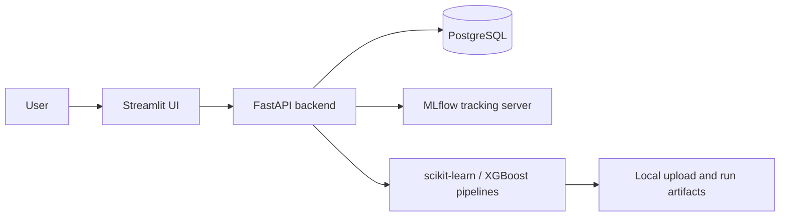

# MLOps Platform — train, compare, and serve tabular models

This repository contains a local MLOps learning project with a FastAPI backend,
a Streamlit interface, PostgreSQL-backed metadata, and MLflow experiment
tracking. It accepts CSV datasets, profiles them, trains and compares a small
set of tabular models, records runs in MLflow, and exposes prediction endpoints.

> **Status:** the project has application code, Dockerfiles, a health test, and
> a GitHub Actions workflow. A complete local orchestration file for PostgreSQL
> and MLflow is not checked in, so the stack is not yet a one-command deployment.

## Architecture



## Implemented workflow

1. Upload a CSV dataset and inspect its inferred columns and preview.
2. Select a target column and classification or regression training mode.
3. Train and tune Logistic/Linear Regression, Decision Tree, Random Forest, and
   XGBoost candidates as applicable.
4. Compare saved metrics and feature importance, then call a protected
   prediction endpoint using the best recorded model.

## Technology stack

| Area | Technologies |
| --- | --- |
| API | FastAPI, SQLAlchemy, Pydantic Settings |
| ML | scikit-learn, XGBoost, MLflow |
| UI | Streamlit, Plotly |
| Services | PostgreSQL, Dockerfiles for backend and frontend |
| Automation | GitHub Actions health test and image builds |

## Repository layout

```text
backend/       FastAPI application, database models, training code, test
frontend/      Streamlit client
docker/        backend and frontend Dockerfiles
data/          local upload directory placeholder
mlruns/        local MLflow artifact placeholder
```

## Local development prerequisites

Python 3.11, PostgreSQL, and an MLflow tracking server are required. Create a
local `.env` from the checked-in template and replace the example API key:

```bash
cp .env.example .env

python -m venv .venv
. .venv/bin/activate
pip install -r backend/requirements.txt
pip install -r frontend/requirements.txt
```

The application expects `DATABASE_URL` and `MLFLOW_TRACKING_URI` from `.env`.
Start the backend and frontend in separate terminals after those services are
available:

```bash
# terminal 1
cd backend
uvicorn app.main:app --reload --port 8000

# terminal 2
cd frontend
streamlit run app.py --server.port 8501
```

## Validation

The repository includes `backend/test/test_health.py` and a CI workflow that
installs backend dependencies, runs the health test, and builds the two Docker
images on `main`. The test configuration uses a local SQLite URL in CI; run the
workflow or test in your environment before treating it as a passing result.

## Limitations and next steps

- Add a versioned Compose or equivalent local orchestration for PostgreSQL and
  MLflow.
- Replace the development-default API key before exposing the service.
- Add broader tests for dataset ingestion, training, persistence, and
  predictions.
- Add artifact storage and deployment documentation before describing the
  project as production-ready.
