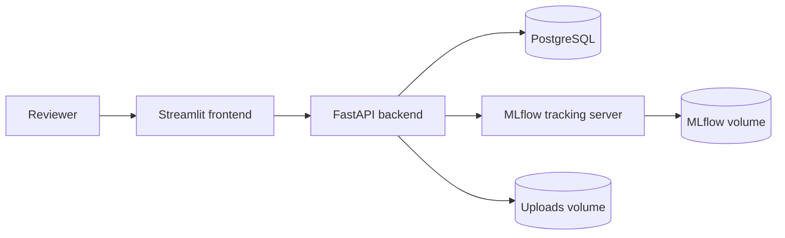

# MLOps Portfolio Demo

A local four-service demo of the tabular ML lifecycle: ingest data, profile it, tune models, track experiments in MLflow, serve predictions with FastAPI, and monitor feature drift.

## Customer-churn case study

The headline example asks: which customers are at risk of leaving so a retention team can prioritize outreach? The preparation script downloads the public IBM Telco Customer Churn sample, removes the customer identifier, converts `TotalCharges` to numeric, and creates stable and deliberately shifted incoming batches.

The raw dataset is not committed. Prepare it with:

```bash
python scripts/prepare_customer_churn.py
```

Source: [IBM Telco Customer Churn data](https://raw.githubusercontent.com/IBM/telco-customer-churn-on-icp4d/master/data/Telco-Customer-Churn.csv), from IBM's archived Apache-2.0 code-pattern repository. The repository notes that separately sourced third-party data may have its own terms, so this project does not redistribute the raw file; the script records the source URL in code and produces only the cleaned demo files under `data/samples/`.

The cleaned dataset has 7,043 rows and 20 columns, a 26.54% churn rate, and 11 missing values (all in `TotalCharges` before numeric imputation). The business-relevant columns include tenure, contract type, monthly and total charges, payment method, internet service, and support subscriptions. `customerID` is removed before the file is written.

## Architecture



## Quick start

1. Copy `.env.example` to `.env` and change `API_KEY`.
2. Prepare the churn samples if needed.
3. Start the stack:

```bash
docker compose up --build
```

Open:

- Streamlit: http://localhost:8501
- FastAPI docs: http://localhost:8000/docs
- MLflow: http://localhost:5000

Upload `data/samples/customer_churn.csv`, choose `Churn` as the target and `classification`, then train. Use the stable and shifted incoming files for batch predictions and drift comparison.

## What the demo proves

- CSV validation, profiling, SHA-256 dataset fingerprints and bounded previews.
- Complete preprocessing pipelines with numeric imputation/scaling and unknown-safe categorical encoding.
- Logistic/linear regression, decision tree, random forest and XGBoost model families.
- Reproducible `RandomizedSearchCV` tuning and untouched holdout evaluation.
- MLflow parameters, metrics, feature importance, signatures, input examples and model artifacts.
- FastAPI single and batch prediction with API-key protection.
- PSI for numeric features and total variation/unseen-category checks for categorical features.
- Aggregate prediction usage and drift reports without storing raw prediction records.

## Evaluation results

The following values are copied from completed MLflow run `90a39193109c45d59997e8d8b3581216` for training run `c0615b6a-9a0e-437b-a960-00f595db6579`. Metrics are weighted across both classes; the positive class is `Yes`.

| Model | ROC-AUC | F1 | Precision | Recall | Accuracy |
|---|---:|---:|---:|---:|---:|
| Logistic regression | 0.8381 | 0.7895 | 0.7880 | 0.7991 | 0.7991 |
| Decision tree | 0.8303 | 0.7947 | 0.7923 | 0.7984 | 0.7984 |
| Random forest | 0.8384 | 0.7929 | 0.7914 | 0.8020 | 0.8020 |
| XGBoost (winner) | 0.8478 | 0.8026 | 0.8012 | 0.8105 | 0.8105 |
| Majority-class baseline | N/A | 0.6222* | 0.5396* | 0.7346* | 0.7346 |

`*` Baseline values are weighted metrics for a classifier that always predicts `No`; its positive-class precision, recall, and F1 are all 0.0000. The selected XGBoost model improves the holdout accuracy by 7.59 percentage points and identifies both churn classes, but the retention decision should still balance recall against outreach cost rather than optimize accuracy alone.

The winning holdout confusion matrix is `[[942, 93], [174, 200]]` (`TN`, `FP`, `FN`, `TP`). Its largest permutation-importance values are `tenure` (0.0584), `Contract` (0.0282), and `InternetService` (0.0168), which are plausible churn drivers but should not be interpreted as causal effects.

Reproduction record: dataset SHA-256 `720603b4b4e5d9b9ca1a477444859ed6a9dd24879e5c2eb88e81920f5efaf3e5`, random seed `42`, Python `3.11`, scikit-learn `1.5.2`, XGBoost `2.1.1`, MLflow `2.17.2`.

After training, submit `incoming_churn_stable.csv` and `incoming_churn_shifted.csv` as batch predictions. In the verified run, the 100-row stable batch reported `stable`, while the deliberately shifted batch reported `drifted` for `tenure`, `MonthlyCharges`, and `Contract` (3 of 19 profiled features). Batches smaller than 30 rows are reported as `insufficient_data`.

## API endpoints

| Endpoint | Purpose |
|---|---|
| `GET /health` | Service health |
| `POST /datasets/upload` | Upload and profile a CSV |
| `GET /datasets/{dataset_id}/preview` | Preview bounded rows |
| `POST /training/run` | Start background training |
| `GET /training/{run_id}` | Read training status/results |
| `POST /training/predict` | Single or batch predictions; requires `x-api-key` |
| `GET /training/{run_id}/monitoring` | Aggregate usage and latest drift report |

## Testing

```bash
cd backend
pip install -r requirements.txt
pytest tests -q
```

GitHub Actions also validates the Compose configuration and builds the backend/frontend images on pull requests and `main`.

## Two-minute walkthrough

1. Run `python scripts/prepare_customer_churn.py` and `docker compose up --build`.
2. Open Streamlit, upload `data/samples/customer_churn.csv`, select `Churn`, and start classification training.
3. Compare the four model rows, open the MLflow link, and inspect the winning model artifact and signature.
4. Use the stable and shifted incoming CSVs in the prediction tab, then compare their drift reports.
5. Restart with `docker compose down` followed by `docker compose up -d` to verify named-volume persistence.

## Repository structure

```text
backend/                 FastAPI service, SQLAlchemy models, ML engine and tests
frontend/                Streamlit application
docker/                  Backend, frontend and MLflow image definitions
scripts/                 Deterministic churn-data preparation script
data/samples/            Generated cleaned churn and drift-demo CSVs
compose.yaml             Local PostgreSQL, MLflow, backend and frontend stack
```

## Limitations

This is a local portfolio demo, not production infrastructure. Background training is in-process, drift thresholds are configurable heuristics, drift detects feature-distribution change rather than model accuracy or concept drift, there is no authentication system beyond a shared demo API key, and there is no model registry workflow.

## Future improvements

Use a durable job queue for training, add delayed-label performance monitoring, introduce migrations for schema evolution, and add a real identity provider before exposing the service outside a local demo.
